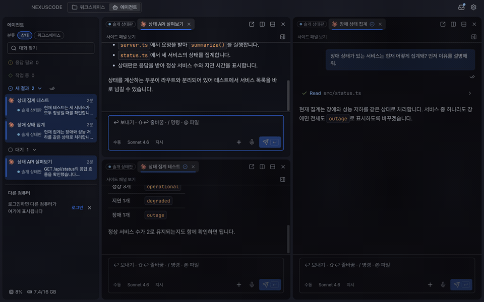
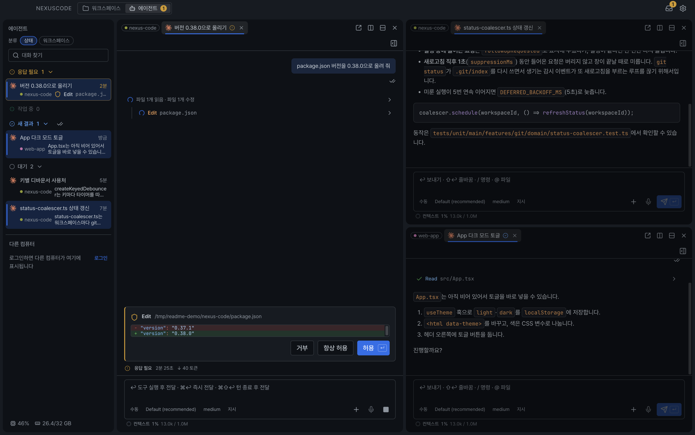
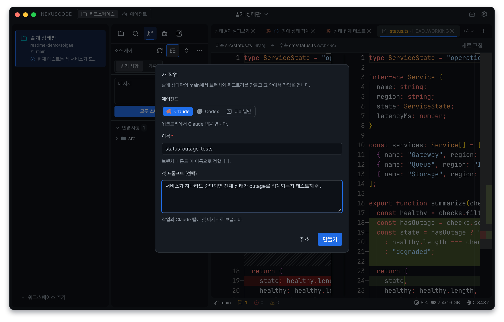
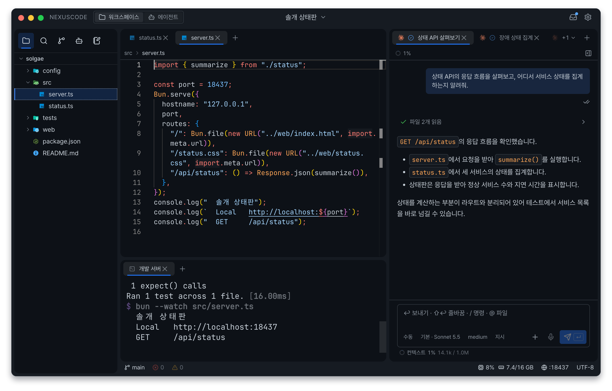
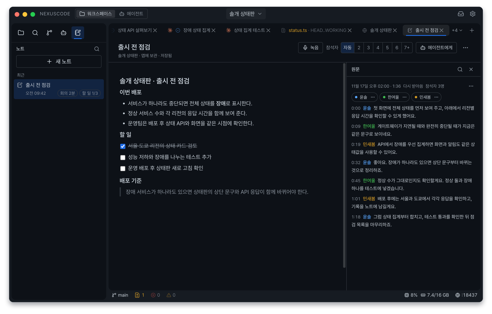
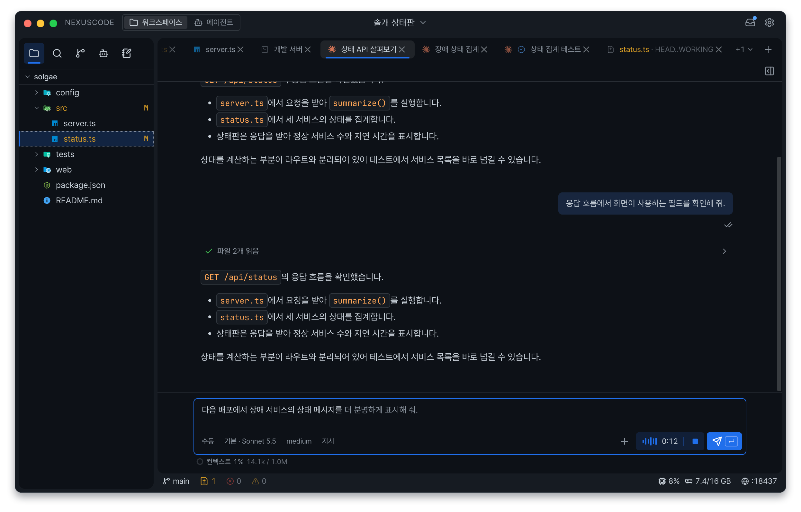

<a id="top" name="top"></a>

<div align="center">
  
  <h1>NexusCode</h1>
  <p><strong>Claude Code와 Codex로 여러 프로젝트를 동시에 진행하는 데스크톱 앱입니다.</strong></p>
  <p>
    <a href="https://nexuscode.gradiendo.com/">웹사이트</a> ·
    <a href="#설치">다운로드</a> ·
    <a href="docs/">문서</a> ·
    <a href="#단축키">단축키</a>
  </p>
  <p>
    <a href="https://github.com/moreih29/nexus-code/releases"></a>
    <a href="https://github.com/moreih29/nexus-code/releases"></a>
    <a href="LICENSE"></a>
    <a href="#설치"></a>
  </p>
  <a href="docs/images/hero-loop.mp4">
    
  </a>
</div>

## 왜 NexusCode인가

Claude Code와 Codex를 프로젝트마다 터미널 탭에서 실행하면 진행 상태를 보거나 권한 요청에 답할 때마다 탭을 오가야 합니다. NexusCode에서는 여러 워크스페이스의 에이전트 세션을 한 화면에서 보고, 권한 요청에도 그 자리에서 답합니다. 에이전트가 고친 코드와 실행 결과는 같은 창의 편집기, 터미널, Git, 브라우저에서 확인합니다.

## 주요 기능

<table>
  <tr>
    <td width="50%">🧩 <a href="#에이전트-뷰와-작업"><strong>여러 에이전트를 한 화면에</strong></a><br />세션을 나란히 보고, 작업마다 Git 워크트리를 따로 만듭니다.</td>
    <td width="50%">🌐 <a href="#원격과-휴대폰"><strong>다른 컴퓨터에서 이어서</strong></a><br />같은 계정으로 연결한 컴퓨터의 대화와 터미널을 이 창에서 봅니다.</td>
  </tr>
  <tr>
    <td>🖥️ <a href="#편집기터미널git브라우저"><strong>편집기·터미널·Git·브라우저를 한 창에</strong></a><br />코드를 고치고 변경 사항과 실행 결과를 확인합니다.</td>
    <td>🎙️ <a href="#노트와-음성"><strong>노트와 음성</strong></a><br />워크스페이스별로 자료를 모으고, 회의를 받아쓰고, 메시지를 말로 입력합니다.</td>
  </tr>
</table>

### 에이전트 뷰와 작업

**에이전트 뷰에서 여러 워크스페이스의 세션을 나란히 봅니다.** 목록을 상태별로 묶으면 응답이 필요한 세션이 맨 위에 오고, 권한 요청에는 그 세션의 패널에서 바로 답합니다.

<picture>
  <source media="(prefers-color-scheme: dark)" srcset="docs/images/agents.png" />
  <source media="(prefers-color-scheme: light)" srcset="docs/images/agents-light.png" />
  
</picture>

**작업마다 브랜치와 Git 워크트리를 만듭니다.** **새 작업**에서 에이전트와 이름을 정하면 그 이름으로 브랜치와 워크트리를 만들고, 그 안에서 Claude나 Codex 탭을 엽니다. 첫 프롬프트를 적으면 탭을 열면서 함께 보냅니다. 작업마다 워크트리가 따로 있어 여러 에이전트가 서로의 변경과 섞이지 않고 동시에 일합니다.



**설정 → 에이전트**에서 **한도가 풀리면 자동으로 이어하기**를 켜면, 구독 사용량 한도에 걸려 멈춘 대화를 한도가 풀린 뒤 자동으로 이어 갑니다.

<a href="#top">맨 위로</a>

### 원격과 휴대폰

**다른 컴퓨터의 세션도 이 창에서 봅니다.** **설정 → 원격**에서 같은 NexusCode 계정으로 로그인한 컴퓨터는 에이전트 뷰의 **다른 컴퓨터** 목록에 나타나고, 그 컴퓨터의 대화, 터미널, 파일을 볼 수 있습니다.

조작은 그 컴퓨터에서 허용한 만큼 할 수 있습니다. **채팅 조작 허용**을 켜 두면 메시지를 보내고 요청에 답하며, **터미널 조작 허용**을 켜 두면 터미널에도 입력합니다.


**iOS 앱은 준비 중입니다.** 출시되면 휴대폰에서 대화와 터미널을 실시간으로 보고, 권한 요청에 답하고, 파일과 Git 변경 사항을 확인할 수 있습니다.

<!-- phone screenshots -->

<a href="#top">맨 위로</a>

### 편집기·터미널·Git·브라우저

**워크스페이스마다 Monaco 편집기, 터미널, 에이전트 탭을 한 화면에 엽니다.** 로컬 폴더나 SSH 호스트의 폴더를 워크스페이스로 열고, 단축키로 워크스페이스를 오갑니다.

<picture>
  <source media="(prefers-color-scheme: dark)" srcset="docs/images/hero.png" />
  <source media="(prefers-color-scheme: light)" srcset="docs/images/hero-light.png" />
  
</picture>

**같은 창에서 변경 사항과 실행 결과를 확인합니다.** 소스 제어에서 파일의 수정 전후를 나란히 비교하고, 개발 서버 페이지를 내장 브라우저 탭에서 엽니다.

<table>
  <tr>
    <td width="50%"></td>
    <td width="50%"></td>
  </tr>
</table>

<a href="#top">맨 위로</a>

### 노트와 음성

**워크스페이스마다 노트를 둡니다.** 메모, 할 일, 파일, 그림을 모으고, **에이전트에게**를 눌러 노트를 새 Claude나 Codex 대화로 보냅니다.

**회의를 녹음하면 말한 사람별로 받아씁니다.** 받아쓴 글은 시각, 화자와 함께 노트 옆에 표시합니다.

**말로 에이전트 메시지를 씁니다.** 한국어와 영어가 섞인 말도 실시간으로 받아쓰고, 자주 쓰는 이름과 용어는 **음성 인식 단어**에 등록할 수 있습니다.

<table>
  <tr>
    <td width="50%"></td>
    <td width="50%"></td>
  </tr>
</table>

<a href="#top">맨 위로</a>

### 에이전트 CLI

**앱 안의 터미널에는 `nexus` 명령이 있습니다.** 에이전트나 사용자가 이 명령으로 다른 세션을 읽고, 새 Claude·Codex 탭을 열고, 파일을 화면에 엽니다.

```bash
nexus session list
nexus chat new --prompt "README를 요약해 주세요"
nexus open README.md
```

다른 워크스페이스를 바꾸는 명령은 **설정 → 에이전트**의 **다른 워크스페이스 변경**에 따라 묻거나 허용하거나 거절합니다.

[전체 CLI 명령](docs/CLI.md) · [워크스페이스 변경 권한](docs/CLI.md#다른-워크스페이스-바꾸기)

<a href="#top">맨 위로</a>

## 설치

- **macOS** (14 이상, Apple Silicon): `NexusCode-arm64.dmg`를 열고 앱을 `/Applications`로 옮기세요. [다운로드](https://github.com/moreih29/nexus-code/releases/latest/download/NexusCode-arm64.dmg)
- **Windows** (11 이상, x64): Microsoft Store에서 설치하세요. ARM PC에서는 x64 에뮬레이션으로 실행합니다. 소스 제어에는 Git for Windows가 필요합니다. [Microsoft Store](https://apps.microsoft.com/detail/9P04CSF0J5ZD) · [Git for Windows](https://git-scm.com/downloads/win)
- **Linux** (x64, arm64): `.deb`나 `.AppImage`를 받으세요. Ubuntu 24.04에서 확인했습니다. [다운로드](https://github.com/moreih29/nexus-code/releases/latest)

<details>
<summary>macOS 첫 실행</summary>

0.38.1부터 macOS 앱과 DMG는 Apple Developer ID로 서명하고 공증했습니다. 처음 열 때 확인되지 않은 개발자 경고가 뜨지 않습니다. 0.37.0 이하는 앱 안에서 업데이트되지 않으니 DMG로 직접 설치하세요.

원격 로그인, 프로필 API 키, 기억한 목소리를 저장해 두었다면 앱 서명이 바뀐 뒤 처음 켤 때 앱이 "키체인을 열까요?"라고 묻습니다. **계속**을 누르고, 이어서 뜨는 macOS 창에서 로그인 암호를 넣은 뒤 **항상 허용**을 고르세요.

직접 빌드해 다른 Mac에서 내려받은 앱처럼 공증되지 않은 앱이 차단되면 [macOS 설치 가이드](docs/INSTALL.md#4-gatekeeper-가-차단할-때)를 보세요.

</details>

<details>
<summary>Linux 설치 및 실행</summary>

| 배포판 | x64 | arm64 |
|---|---|---|
| Debian·Ubuntu | [`NexusCode-amd64.deb`](https://github.com/moreih29/nexus-code/releases/latest/download/NexusCode-amd64.deb) | [`NexusCode-arm64.deb`](https://github.com/moreih29/nexus-code/releases/latest/download/NexusCode-arm64.deb) |
| 그 밖의 배포판 | [`NexusCode-x86_64.AppImage`](https://github.com/moreih29/nexus-code/releases/latest/download/NexusCode-x86_64.AppImage) | [`NexusCode-arm64.AppImage`](https://github.com/moreih29/nexus-code/releases/latest/download/NexusCode-arm64.AppImage) |

Debian·Ubuntu에서는 내려받은 폴더에서 `.deb`를 설치하세요. arm64에서는 `NexusCode-arm64.deb`입니다.

```bash
sudo apt install ./NexusCode-amd64.deb
```

AppImage는 실행 권한을 준 뒤 여세요. arm64에서는 `NexusCode-arm64.AppImage`입니다.

```bash
chmod +x NexusCode-x86_64.AppImage
./NexusCode-x86_64.AppImage
```

Ubuntu 23.10 이상에서는 AppImage를 처음 실행하기 전에 AppArmor 프로필을 한 번 등록하세요. [AppArmor 프로필 등록 방법](docs/INSTALL.md#ubuntu-2310-이상에서-appimage-가-바로-종료될-때)

</details>

Intel Mac에서는 소스에서 직접 빌드할 수 있습니다. [자체 빌드 가이드](docs/INSTALL.md#self-build)

<a href="#top">맨 위로</a>

## 개인정보와 보안

기기 사이에 오가는 에이전트 세션, 터미널 화면, 파일은 **종단 간 암호화**합니다. 서버는 어느 기기에서 어느 기기로 가는지와 크기, 시각만 알 수 있고, 내용을 열거나 저장하지 않습니다.

음성 입력과 노트 녹음은 종단 간 암호화하지 않습니다. 소리는 서버를 거쳐 음성 인식 서비스 Soniox로 가고, 받아쓴 글도 서버를 거쳐 앱으로 돌아옵니다. 자세한 내용은 [개인정보처리방침](https://nexuscode.gradiendo.com/privacy/)에 있습니다.

원격, 음성 입력, 노트 녹음과 출시 예정인 iOS 앱에는 **NexusCode 계정**이 필요합니다. 나머지 기능은 계정 없이 사용할 수 있습니다.

계정 기능은 NexusCode가 운영하는 서버를 거치며, 자체 호스팅은 지원하지 않습니다. 지금은 무료이지만 서버와 음성 인식에 계정마다 비용이 들어 나중에 유료 요금제가 생길 수 있습니다.

<a href="#top">맨 위로</a>

## 단축키

| 동작 | macOS | Windows / Linux |
|---|---|---|
| 워크스페이스 추가 | `⌘⇧N` | `Ctrl+Shift+N` |
| 이전 / 다음 워크스페이스 | `⌘⌃↑` / `⌘⌃↓` | `Win+Ctrl+↑` / `Win+Ctrl+↓` (Linux는 `Super`) |
| 새 터미널 | `⌘T` | `Ctrl+Shift+T` |
| 워크스페이스 / 에이전트 뷰 전환 | `⌘⇧A` | `Ctrl+Shift+A` |

[전체 단축키](docs/SHORTCUTS.md)

## 업데이트

macOS와 Linux 앱은 새 버전을 스스로 확인하고, 알림에서 업데이트합니다. 릴리스 노트는 **설정 → 정보**에서 볼 수 있습니다. Windows는 Microsoft Store가 업데이트합니다. [업데이트 안내](docs/INSTALL.md#업데이트)

## 자체 빌드

빌드 요구사항과 운영체제별 명령은 [자체 빌드 가이드](docs/INSTALL.md#self-build)에 있습니다.

## 라이선스

[MIT](LICENSE) © moreih29
