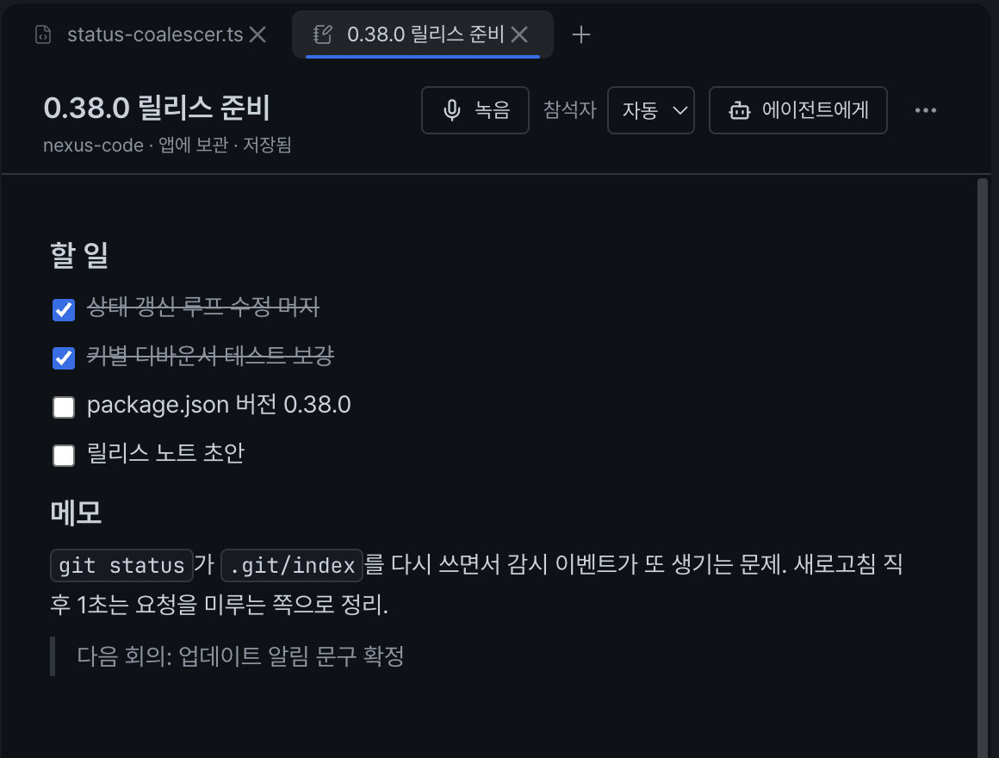

<div align="center">

# NexusCode

**여러 워크스페이스의 편집기, 터미널, Claude Code와 Codex를 한 창에서 쓰는 데스크톱 앱입니다.**

다른 컴퓨터에서 작업을 이어 가고, 노트에 자료를 모으거나 음성으로 메시지를 입력할 수 있습니다.

[](https://github.com/moreih29/nexus-code/releases)
[](https://github.com/moreih29/nexus-code/releases)
[](LICENSE)


**[설치](#설치) · [주요 기능](#주요-기능) · [단축키](#단축키)**


</div>

## 설치

| 운영체제 | 요구사항 | 설치 |
|---|---|---|
| macOS | macOS 14 (Sonoma) 이상, Apple Silicon | [GitHub Releases](https://github.com/moreih29/nexus-code/releases/latest)에서 `NexusCode-X.Y.Z-arm64.dmg`를 받아 엽니다. NexusCode를 `/Applications`에 옮기세요. |
| Windows | Windows 11 이상, x64 (ARM PC에서는 x64 에뮬레이션) | [Microsoft Store](https://apps.microsoft.com/detail/9P04CSF0J5ZD)에서 설치하세요. 소스 제어에는 [Git for Windows](https://git-scm.com/downloads/win)가 필요합니다. |
| Linux | x64 또는 arm64, Ubuntu 24.04에서 확인 | [GitHub Releases](https://github.com/moreih29/nexus-code/releases/latest)에서 `.deb` 또는 `.AppImage`를 받으세요. |

<details>
<summary>macOS 첫 실행 보안 해제 (Gatekeeper)</summary>

현재 macOS 릴리스는 자체 서명 인증서를 사용하며 Apple Developer ID 서명과 공증 없이 배포됩니다. macOS가 앱을 차단하거나 ‘손상된 앱’으로 표시할 수 있습니다. 앱을 `/Applications`에 옮긴 뒤 터미널에서 아래 명령을 실행하고 앱을 여세요.

```bash
xattr -dr com.apple.quarantine "/Applications/NexusCode.app"
```

처음 설치할 때 한 번만 하면 됩니다. Finder나 시스템 설정에서 해제하는 방법은 [macOS 설치 가이드](docs/INSTALL.md#3-gatekeeper-우회)에 있습니다.

</details>

<details>
<summary>Linux 설치 및 실행</summary>

| 배포판 | x64 | arm64 |
|---|---|---|
| Debian·Ubuntu | `NexusCode-X.Y.Z-amd64.deb` | `NexusCode-X.Y.Z-arm64.deb` |
| 그 밖의 배포판 | `NexusCode-X.Y.Z-x86_64.AppImage` | `NexusCode-X.Y.Z-arm64.AppImage` |

Debian·Ubuntu에서는 내려받은 폴더에서 `.deb`를 설치하세요.

```bash
sudo apt install ./NexusCode-X.Y.Z-*.deb
```

AppImage는 실행 권한을 주고 바로 열 수 있습니다.

```bash
chmod +x NexusCode-X.Y.Z-*.AppImage
./NexusCode-X.Y.Z-*.AppImage
```

Ubuntu 23.10 이상에서 AppImage를 실행하려면 [AppArmor 프로필 등록](docs/INSTALL.md#ubuntu-2310-이상에서-appimage-가-바로-종료될-때)이 필요합니다.

</details>

Intel Mac에서는 [소스에서 직접 빌드](docs/INSTALL.md#self-build)할 수 있습니다.

## 주요 기능

### 워크스페이스와 편집기

- **여러 워크스페이스를 한 창에서.** 프로젝트마다 파일 트리, 탭, 터미널을 따로 두고 단축키로 오갑니다. 로컬 폴더를 열거나 **SSH로 연결…**에서 원격 호스트의 폴더를 엽니다.
- **Monaco 편집기와 통합 터미널.** 화면을 좌우나 상하로 나눠 코드와 터미널을 함께 봅니다. **설정 → 언어 서버**에서 자동 완성, 정의로 이동, 오류 표시를 켤 수 있습니다.

### AI 에이전트

- **Claude Code·Codex 탭.** 워크스페이스가 실행되는 컴퓨터에 설치한 에이전트와 전용 탭에서 대화합니다. **설정 → Claude / Codex**에서 계정, API 키, 호환 게이트웨이용 프로필을 설정합니다.
- **에이전트 뷰.** 여러 워크스페이스의 세션을 분할 패널에 나란히 놓고 작업 상태를 보거나 권한 요청에 답합니다.
- **작업.** **새 작업…**으로 브랜치와 Git 워크트리를 만들고, 에이전트마다 별도 작업에서 동시에 맡은 일을 진행하게 할 수 있습니다.
- **사용량 한도 이어하기.** 구독 요금제의 사용량 한도에 걸려 멈춘 대화는 한도가 풀리면 자동으로 이어서 진행합니다.

<div align="center">
  
</div>

### 원격과 모바일

- **다른 컴퓨터에서 이어서 작업.** **설정 → 원격**에서 Google 또는 GitHub로 로그인하면 같은 계정으로 연결한 컴퓨터의 채팅, 터미널, 파일을 볼 수 있습니다. 조작을 허용하면 메시지를 보내고 권한 요청에 답하거나 터미널에 입력할 수 있습니다.
- **iOS 앱 준비 중.** 출시되면 휴대폰에서 채팅과 터미널을 실시간으로 보고, 권한 요청에 답하거나 파일과 Git 변경 내용을 확인할 수 있습니다.

### 노트와 음성

- **노트.** 워크스페이스별로 글, 할 일, 파일, 그림을 모으고 필요한 내용을 에이전트에 보냅니다.
- **음성 입력.** 한국어와 영어가 섞인 말도 실시간으로 받아써 메시지를 작성합니다. 자주 쓰는 이름이나 용어는 **음성 인식 단어**에 등록할 수 있습니다.
- **노트 녹음.** 컴퓨터에서 회의를 녹음하며 말을 글로 옮기고 화자별로 나눕니다. 여러 사람이 말한 녹음은 끝난 뒤 한 번 더 받아써 정확도를 높입니다.

<div align="center">
  
</div>

원격, 음성 입력, 노트 녹음, 모바일 앱에는 **NexusCode 계정** 로그인이 필요합니다. 나머지 기능은 NexusCode 계정 없이 쓸 수 있습니다.

계정 기능은 NexusCode가 운영하는 서버를 거치며, 서버를 직접 운영하는 자체 호스팅은 지원하지 않습니다. 지금은 무료로 제공하지만, 서버와 음성 인식에 계정마다 비용이 들어 나중에 유료 요금제가 생길 수 있습니다.

### 에이전트 CLI

앱 안 터미널에서 `nexus` 명령으로 다른 세션을 확인하거나, 파일과 변경 내용을 화면에 열고, 내장 브라우저를 조작할 수 있습니다. 다른 워크스페이스를 바꾸는 권한은 **설정 → 에이전트 → 다른 워크스페이스 변경**에서 정합니다. [CLI 사용 가이드](docs/CLI.md)

## 개인정보와 보안

기기 사이에 오가는 채팅, 터미널, 파일, 세션 목록은 **종단 간 암호화**됩니다. 중계 서버는 암호문과 전달에 필요한 정보만 보고, 대화 기록을 저장하지 않습니다.

음성 입력과 노트 녹음은 종단 간 암호화 대상에서 제외됩니다. 오디오는 서버를 거쳐 음성 인식 서비스 Soniox에 전달되고, 받아쓴 글도 서버를 거쳐 앱으로 돌아옵니다. [개인정보처리방침](docs/PRIVACY.md)

## 단축키

| 동작 | macOS | Windows / Linux |
|---|---|---|
| 워크스페이스 추가 | `⌘⇧N` | `Ctrl+Shift+N` |
| 이전 / 다음 워크스페이스 | `⌘⌃↑` / `⌘⌃↓` | `Win+Ctrl+↑` / `Win+Ctrl+↓` (Linux는 `Super`) |
| 새 터미널 | `⌘T` | `Ctrl+Shift+T` |
| 워크스페이스 / 에이전트 뷰 전환 | `⌘⇧A` | `Ctrl+Shift+A` |

[전체 단축키](docs/SHORTCUTS.md)

## 업데이트

macOS와 Linux는 앱에서 업데이트합니다. **설정 → 정보**에서 새 버전을 확인하고 릴리스 노트를 볼 수 있습니다. Windows는 Microsoft Store에서 업데이트합니다. [업데이트 안내](docs/INSTALL.md#업데이트)

## 자체 빌드

빌드 요구사항과 운영체제별 명령은 [자체 빌드 가이드](docs/INSTALL.md#self-build)에 있습니다.

## 라이선스

[MIT](LICENSE) © moreih29
