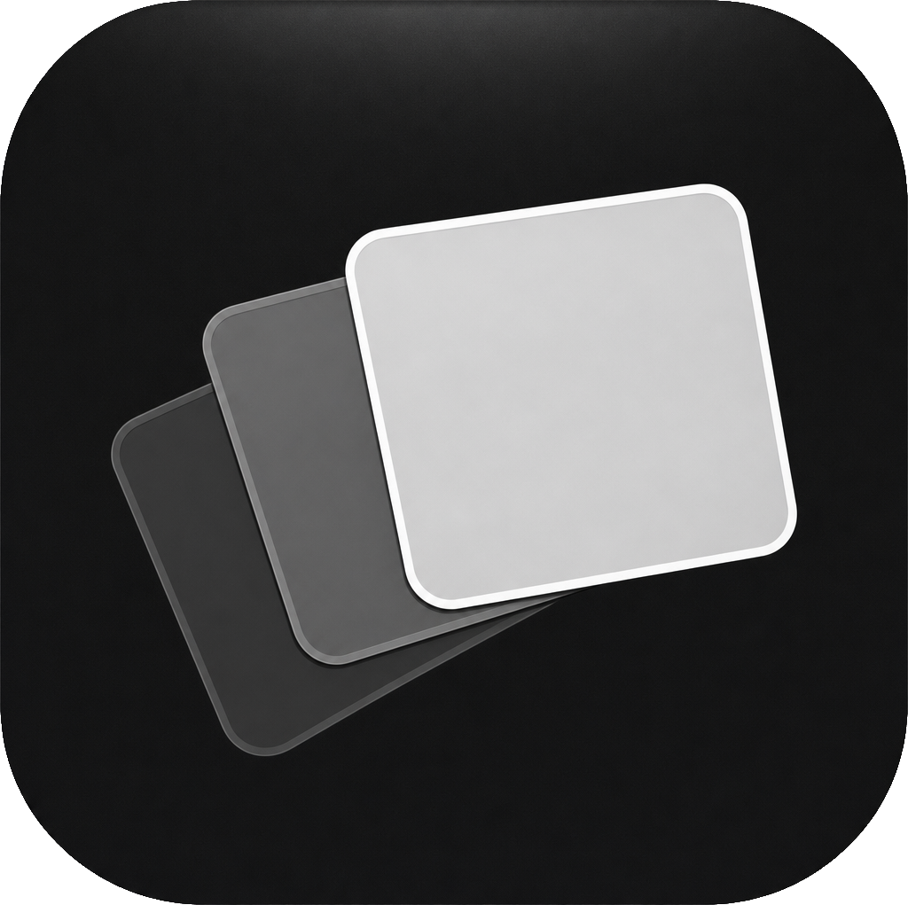
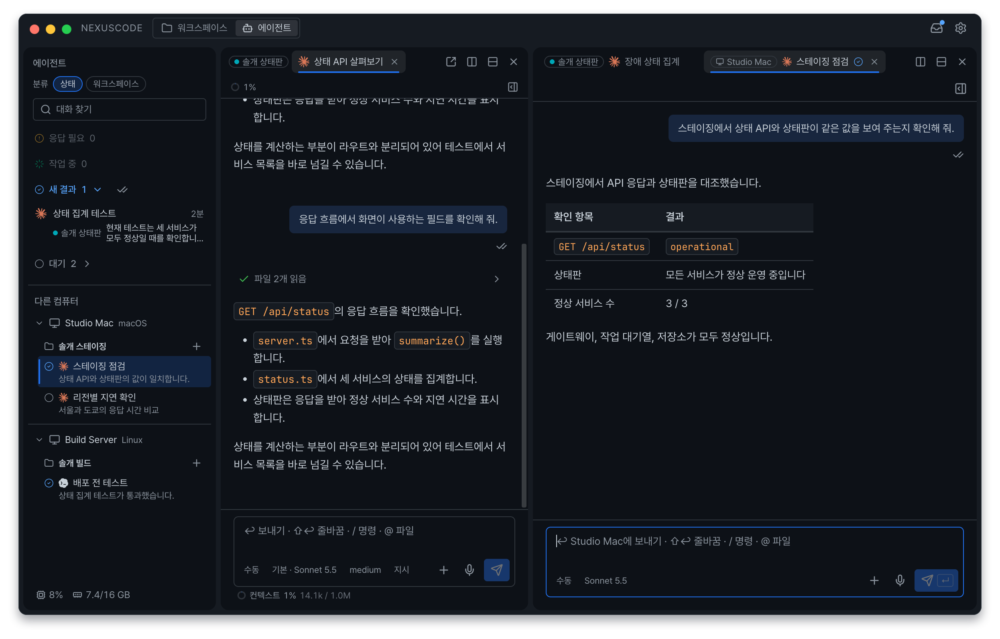
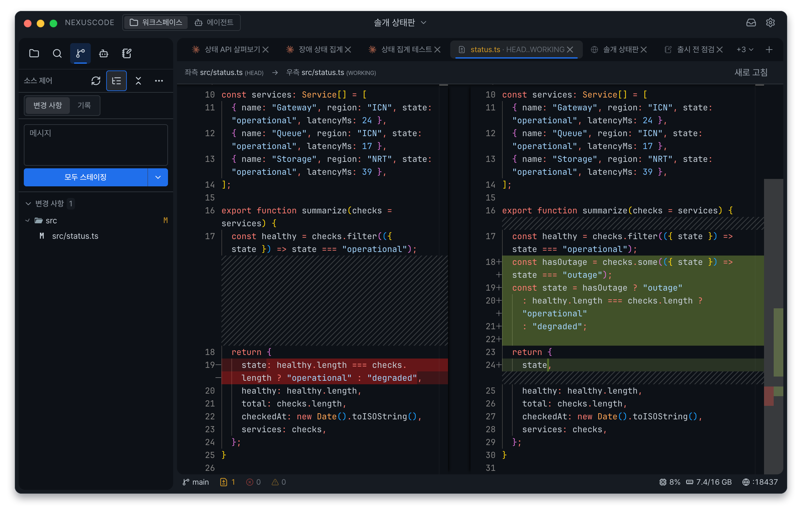
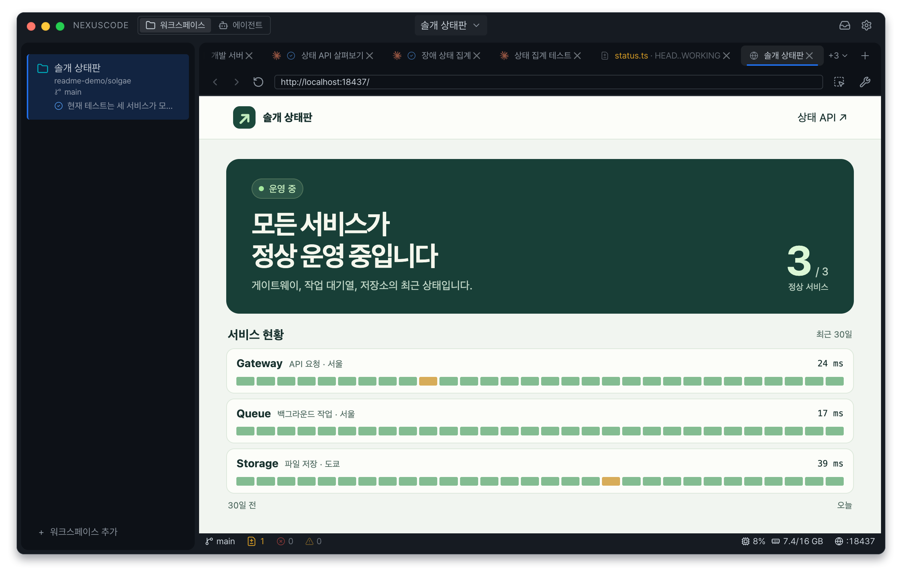

<a id="top" name="top"></a>

<div align="center">
  
  <h1>NexusCode</h1>
  <p><strong>Claude Code와 Codex로 여러 프로젝트를 동시에 진행하는 데스크톱 앱입니다.</strong></p>
  <p>
    <a href="#설치">다운로드</a> ·
    <a href="docs/">문서</a> ·
    <a href="#단축키">단축키</a>
  </p>
  <p>
    <a href="https://github.com/moreih29/nexus-code/releases"></a>
    <a href="https://github.com/moreih29/nexus-code/releases"></a>
    <a href="LICENSE"></a>
    <a href="#설치"></a>
  </p>
  <a href="docs/images/hero-loop.mp4">
    
  </a>
</div>

## 왜 NexusCode인가

Claude Code와 Codex를 프로젝트마다 터미널 탭에서 실행하면 진행 상태와 권한 요청을 확인할 때마다 탭을 오갑니다.\
NexusCode에서는 여러 워크스페이스의 에이전트를 동시에 실행하고 한곳에서 권한 요청에 답합니다.\
편집기와 터미널을 함께 열고, 같은 창에서 Git 변경 사항과 브라우저에 띄운 개발 서버를 확인합니다.\
다른 컴퓨터에서 기존 세션을 이어서 사용합니다. 휴대폰용 iOS 앱도 준비 중입니다.

## 주요 기능

<table>
  <tr>
    <td width="50%">🧩 <a href="#에이전트-뷰와-작업"><strong>병렬 에이전트와 작업</strong></a><br />세션을 나란히 보고 작업마다 Git 워크트리를 만듭니다.</td>
    <td width="50%">🌐 <a href="#원격과-휴대폰"><strong>어디서든 이어서</strong></a><br />연결한 다른 컴퓨터에서 채팅과 터미널을 이어서 사용합니다.</td>
  </tr>
  <tr>
    <td>🖥️ <a href="#편집기터미널git브라우저"><strong>편집기·터미널·Git·브라우저를 한 창에</strong></a><br />코드를 고치고 변경 사항과 실행 결과를 확인합니다.</td>
    <td>🎙️ <a href="#노트와-음성"><strong>노트와 음성</strong></a><br />워크스페이스별로 자료를 모으고 회의를 받아씁니다.</td>
  </tr>
</table>

### 에이전트 뷰와 작업

**여러 워크스페이스의 세션을 나란히 봅니다.** Claude Code와 Codex의 진행 상태를 확인하고 에이전트 뷰에서 권한 요청에 답합니다.

<picture>
  <source media="(prefers-color-scheme: dark)" srcset="docs/images/agents.png" />
  <source media="(prefers-color-scheme: light)" srcset="docs/images/agents-light.png" />
  
</picture>

**작업마다 브랜치와 Git 워크트리를 만듭니다.** 에이전트가 서로 다른 워크트리에서 맡은 일을 동시에 진행합니다.


**사용량 한도 이어하기**를 켜면 구독 한도에 걸려 멈춘 대화를 한도가 풀린 뒤 자동으로 재개합니다.

<a href="#top">맨 위로</a>

### 원격과 휴대폰

**다른 컴퓨터에서 작업을 이어서 진행합니다.** 같은 NexusCode 계정으로 연결한 컴퓨터의 채팅·터미널·파일을 확인하고, 원격 조작을 허용하면 메시지를 보내거나 권한 요청에 답할 수 있습니다.



**iOS 앱을 준비 중입니다.** 출시되면 휴대폰에서 채팅과 터미널을 실시간으로 보고, 권한 요청에 답하거나 파일과 Git 변경 사항을 확인할 수 있습니다.

<!-- phone screenshots -->

<a href="#top">맨 위로</a>

### 편집기·터미널·Git·브라우저

**Monaco 편집기와 터미널을 나란히 엽니다.** 로컬 폴더와 SSH 호스트의 폴더를 워크스페이스로 열고 단축키로 오갑니다.

<picture>
  <source media="(prefers-color-scheme: dark)" srcset="docs/images/hero.png" />
  <source media="(prefers-color-scheme: light)" srcset="docs/images/hero-light.png" />
  
</picture>

**코드를 고친 창에서 결과를 확인합니다.** Git 변경 전후를 비교하고 개발 서버의 페이지를 내장 브라우저에서 엽니다.

<table>
  <tr>
    <td width="50%"></td>
    <td width="50%"></td>
  </tr>
</table>

<a href="#top">맨 위로</a>

### 노트와 음성

**회의를 녹음하고 화자별로 받아씁니다.** 워크스페이스별 노트에 메모, 할 일, 파일, 그림을 모아 에이전트에 보낼 수 있습니다.

**말로 에이전트 메시지를 작성합니다.** 한국어와 영어가 섞인 말도 실시간으로 받아씁니다.

<table>
  <tr>
    <td width="50%"></td>
    <td width="50%"></td>
  </tr>
</table>

<a href="#top">맨 위로</a>

### 에이전트 CLI

**앱 안의 터미널에서 `nexus`로 NexusCode를 다룹니다.** 사용자와 에이전트가 세션을 확인하거나 새 채팅을 열고 파일을 화면에 띄울 수 있습니다.

```bash
nexus session list
nexus chat new --prompt "README를 요약해 주세요"
nexus open README.md
```

[전체 CLI 명령](docs/CLI.md) · [워크스페이스 변경 권한](docs/CLI.md#다른-워크스페이스-바꾸기)

<a href="#top">맨 위로</a>

## 설치

- **macOS 14 이상 (Apple Silicon)**에서 `NexusCode-X.Y.Z-arm64.dmg`를 열고 앱을 `/Applications`에 옮기세요. [다운로드](https://github.com/moreih29/nexus-code/releases/latest)
- **Windows 11 이상 (x64)**에서는 Microsoft Store에서 설치하세요. ARM PC는 x64 에뮬레이션으로 실행하며, Git 소스 제어에는 Git for Windows가 필요합니다. [Microsoft Store](https://apps.microsoft.com/detail/9P04CSF0J5ZD) · [Git for Windows](https://git-scm.com/downloads/win)
- **Linux (x64·arm64)**에서는 `.deb` 또는 `.AppImage`를 받으세요. Ubuntu 24.04에서 동작을 확인했습니다. [다운로드](https://github.com/moreih29/nexus-code/releases/latest)

<details>
<summary>macOS 첫 실행 보안 해제 (Gatekeeper)</summary>

macOS 릴리스는 자체 서명 인증서를 사용하며 Apple Developer ID 서명과 공증 없이 배포합니다. macOS가 앱을 차단하거나 ‘손상된 앱’으로 표시하면, 앱을 `/Applications`에 옮긴 뒤 터미널에서 아래 명령을 실행하고 앱을 여세요.

```bash
xattr -dr com.apple.quarantine "/Applications/NexusCode.app"
```

처음 설치할 때 한 번만 하면 됩니다. Finder와 시스템 설정에서 해제하는 방법도 확인할 수 있습니다. [macOS 설치 가이드](docs/INSTALL.md#3-gatekeeper-우회)

</details>

<details>
<summary>Linux 설치 및 실행</summary>

| 배포판 | x64 | arm64 |
|---|---|---|
| Debian·Ubuntu | `NexusCode-X.Y.Z-amd64.deb` | `NexusCode-X.Y.Z-arm64.deb` |
| 그 밖의 배포판 | `NexusCode-X.Y.Z-x86_64.AppImage` | `NexusCode-X.Y.Z-arm64.AppImage` |

Debian·Ubuntu에서는 내려받은 폴더에서 `.deb`를 설치하세요.

```bash
sudo apt install ./NexusCode-X.Y.Z-*.deb
```

AppImage는 실행 권한을 준 뒤 여세요.

```bash
chmod +x NexusCode-X.Y.Z-*.AppImage
./NexusCode-X.Y.Z-*.AppImage
```

Ubuntu 23.10 이상에서 AppImage를 실행하려면 AppArmor 프로필을 등록하세요. [AppArmor 프로필 등록 방법](docs/INSTALL.md#ubuntu-2310-이상에서-appimage-가-바로-종료될-때)

</details>

Intel Mac에서는 소스에서 직접 빌드할 수 있습니다. [자체 빌드 가이드](docs/INSTALL.md#self-build)

<a href="#top">맨 위로</a>

## 개인정보와 보안

기기 사이에 오가는 채팅, 터미널, 파일, 세션 목록에는 **종단 간 암호화**를 적용합니다. 중계 서버는 암호문과 전달에 필요한 정보만 처리하고 대화 기록은 저장하지 않습니다.

음성 입력과 노트 녹음에는 종단 간 암호화가 적용되지 않습니다. 오디오는 서버를 거쳐 음성 인식 서비스 Soniox에 전달하며, 받아쓴 글도 서버를 거쳐 앱으로 돌려보냅니다. [개인정보처리방침](docs/PRIVACY.md)

원격, 음성 입력, 노트 녹음과 출시 예정인 iOS 앱에는 **NexusCode 계정**이 필요합니다. 그 밖의 기능은 NexusCode 계정 없이 사용할 수 있습니다.

계정 기능은 NexusCode가 운영하는 서버를 사용하며 자체 호스팅은 지원하지 않습니다. 현재 무료로 제공하지만 서버와 음성 인식에 계정별 비용이 들어 나중에 유료 요금제가 생길 수 있습니다.

<a href="#top">맨 위로</a>

## 단축키

| 동작 | macOS | Windows / Linux |
|---|---|---|
| 워크스페이스 추가 | `⌘⇧N` | `Ctrl+Shift+N` |
| 이전 / 다음 워크스페이스 | `⌘⌃↑` / `⌘⌃↓` | `Win+Ctrl+↑` / `Win+Ctrl+↓` (Linux는 `Super`) |
| 새 터미널 | `⌘T` | `Ctrl+Shift+T` |
| 워크스페이스 / 에이전트 뷰 전환 | `⌘⇧A` | `Ctrl+Shift+A` |

[전체 단축키](docs/SHORTCUTS.md)

## 업데이트

macOS와 Linux에서는 앱에서 새 버전과 릴리스 노트를 확인하고 업데이트합니다. Windows는 Microsoft Store에서 업데이트합니다. [업데이트 안내](docs/INSTALL.md#업데이트)

## 자체 빌드

빌드 요구사항과 운영체제별 명령을 확인하세요. [자체 빌드 가이드](docs/INSTALL.md#self-build)

## 라이선스

[MIT](LICENSE) © moreih29
