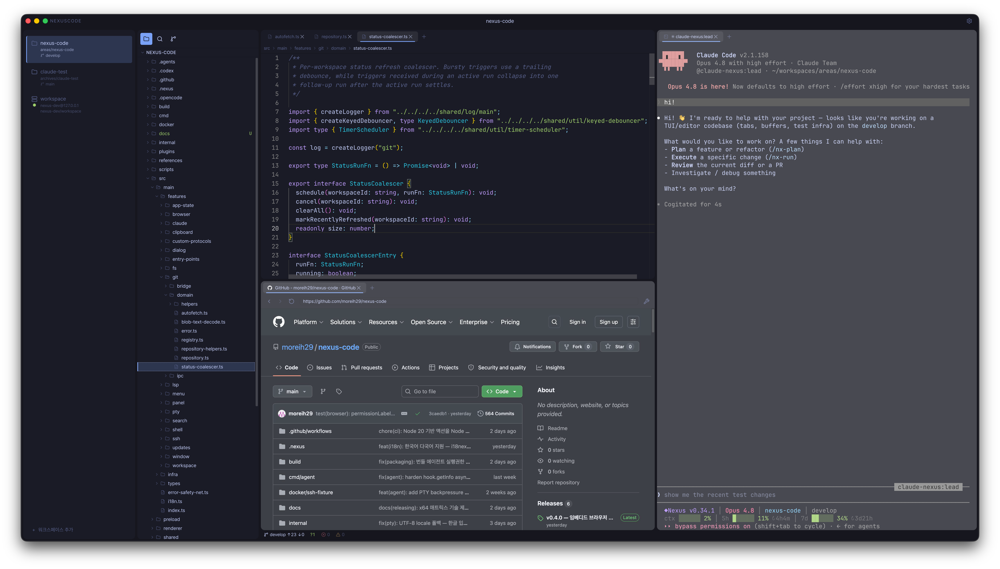
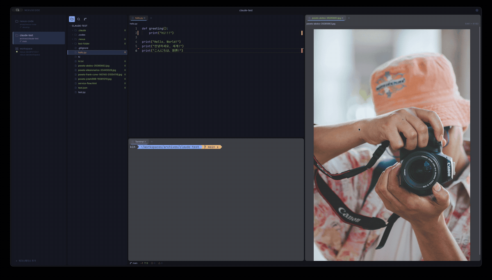

<div align="center">

# NexusCode

**한 창에서 여러 워크스페이스를.** macOS · Windows · Linux 용 VSCode-style 에디터 — Monaco 에디터와 통합 터미널을 하나의 창에 담았습니다.

[](https://github.com/moreih29/nexus-code/releases)
[](https://github.com/moreih29/nexus-code/releases)
[](LICENSE)




</div>

## 왜 NexusCode 인가

VSCode 로 여러 프로젝트를 동시에 다루려면 창을 여러 개 띄워야 합니다. NexusCode 는 **하나의 창 안에 여러 워크스페이스**를 담습니다. 각 워크스페이스는 자기만의 파일 트리 · 에디터 그룹 · 터미널을 가지며, 단축키 하나로 즉시 전환됩니다. 로컬 폴더든 SSH 원격 호스트든 같은 방식으로 다룹니다.

VSCode 가 주는 IDE 경험은 그대로, 멀티 워크스페이스는 VSCode 가 못 주는 방식으로.

## ✨ 주요 기능

<div align="center">
  
</div>

- **멀티 워크스페이스** — 한 창에서 여러 워크스페이스를 두고 `⌘⌃↑` · `⌘⌃↓` 로 전환. 각자 독립된 파일 트리 · 탭 · 터미널.
- **분할 그룹** — 에디터를 좌우(`⌘\`) · 상하(`⌘⇧\`)로 분할하고 그룹 간 포커스 이동.
- **Monaco 에디터 + 통합 터미널** — VSCode 와 동일한 Monaco 에디터, xterm 기반 터미널을 한 화면에.
- **SSH 원격 워크스페이스** — 원격 호스트(Linux · macOS)의 폴더를 로컬처럼 편집. 워크스페이스 추가 화면의 **SSH로 연결…** 에서 `user@host` 나 `~/.ssh/config` 별칭으로 연결합니다.
- **작업 (git 워크트리)** — 타이틀바의 워크스페이스 이름을 눌러 **새 작업…** 을 고르면, 저장소에 새 브랜치와 워크트리를 만들고 그 안에서 작업을 엽니다. 작업 터미널은 코딩 에이전트(기본 `claude`)를 첫 프롬프트와 함께 실행하므로, 에이전트 여러 개를 브랜치별로 나란히 돌릴 수 있습니다. 워크트리는 `~/.nexus-code/worktrees` 에 생기고(SSH 워크스페이스는 원격 홈의 같은 경로), 실행할 명령은 설정 › 터미널에서 바꿉니다.
- **언어 서버 (실험적)** — 설정 › 편집기에서 켜면 TypeScript · Python 자동 완성, 정의로 이동, 진단을 씁니다. 서버와 실행 환경이 앱에 들어 있어 Node 를 따로 설치할 필요가 없습니다(SSH 워크스페이스도 마찬가지). Go(gopls) · Rust(rust-analyzer) 는 직접 설치한 서버를 쓰며, 설정에서 켜면 워크스페이스가 있는 호스트의 PATH 와 `~/go/bin` · `~/.cargo/bin` 에서 찾습니다(경로를 직접 지정할 수도 있습니다). 파일을 열면 그 언어의 서버가 시작되고, 설정은 바로 적용됩니다. 상태 표시줄의 언어 이름을 누르면 서버 상태와 메모리를 보고, 다시 시작하거나 로그를 보거나 그 워크스페이스에서만 끌 수 있습니다.
- **VSCode 호환 단축키** — 익숙한 키 매핑 그대로.

## 요구사항

- **macOS** — macOS 14 (Sonoma) 이상, Apple Silicon (M1 / M2 / M3 / M4)
- **Windows** — Windows 11 이상, x64 (ARM PC 는 x64 에뮬레이션으로 실행). 소스 제어에는 [Git for Windows](https://git-scm.com/downloads/win) 가 필요합니다.
- **Linux** — x64 또는 arm64. Ubuntu 24.04 에서 확인했습니다.

> macOS 는 Apple Silicon (arm64) 빌드만 제공합니다. Intel (x64) Mac 은 소스 빌드로 사용 가능 — [docs/INSTALL.md#self-build](docs/INSTALL.md) 참고.

## 📦 설치

### macOS

[Releases 페이지](https://github.com/moreih29/nexus-code/releases)에서 최신 `.dmg` 를 내려받습니다.

| Mac | 파일 |
|---|---|
| Apple Silicon | `NexusCode-X.Y.Z-arm64.dmg` |

`.dmg` 를 마운트하고 **NexusCode** 를 `/Applications` 로 드래그한 뒤, 첫 실행 전에 아래 **보안 해제**를 거칩니다.

#### 보안 해제 (Gatekeeper)

NexusCode 는 Apple Developer ID / 공증(notarization) 없이, 자체 서명 인증서로 서명해 배포됩니다. 첫 실행 시 macOS 가 앱을 차단하거나 "손상된 앱" 으로 표시하는 것은 정상입니다. 터미널에서 quarantine 속성을 제거하면 이후 더블클릭으로 바로 열립니다:

```bash
xattr -dr com.apple.quarantine "/Applications/NexusCode.app"
```

보안 해제는 처음 설치할 때 한 번만 하면 됩니다. 이후 버전은 앱 안에서 업데이트하므로([업데이트](#-업데이트)) 다시 해제할 필요가 없습니다.

<details>
<summary>터미널 대신 GUI 로 해제하기</summary>

**macOS 14 (Sonoma)**

1. Finder 에서 `/Applications/NexusCode.app` 우클릭 (또는 Control+클릭)
2. **열기** 선택
3. "이 앱을 열 수 없습니다" 다이얼로그에서 **열기** 클릭

**macOS 15 (Sequoia) 이상**

1. 앱을 더블클릭 → 차단 알림 확인
2. **시스템 설정 → 개인정보 보호 및 보안** 으로 이동
3. 하단 "NexusCode 차단됨" 항목 옆 **그래도 열기** 클릭
4. 확인 다이얼로그에서 **열기**

자세한 단계는 [docs/INSTALL.md](docs/INSTALL.md) 참고.

</details>

### Windows

[Microsoft Store](https://apps.microsoft.com/detail/9P04CSF0J5ZD) 에서 설치합니다. 업데이트도 Store 가 합니다.

### Linux

[Releases 페이지](https://github.com/moreih29/nexus-code/releases)에서 배포판에 맞는 파일을 내려받습니다.

| 형식 | x64 | arm64 |
|---|---|---|
| deb (Debian · Ubuntu) | `NexusCode-X.Y.Z-amd64.deb` | `NexusCode-X.Y.Z-arm64.deb` |
| AppImage (그 밖의 배포판) | `NexusCode-X.Y.Z-x86_64.AppImage` | `NexusCode-X.Y.Z-arm64.AppImage` |

**deb** — Debian · Ubuntu 에서 권장합니다. 내려받은 폴더에서:

```bash
sudo apt install ./NexusCode-X.Y.Z-*.deb
```

**AppImage** — 실행 권한을 주고 바로 실행합니다. 설치 과정이 없습니다.

```bash
chmod +x NexusCode-X.Y.Z-*.AppImage
./NexusCode-X.Y.Z-*.AppImage
```

> Ubuntu 23.10 이상에서는 AppImage 가 `The SUID sandbox helper binary was found, but is not configured correctly` 를 내고 바로 종료됩니다. 이 버전의 AppArmor 가 앱의 샌드박스를 막기 때문입니다. deb 는 설치할 때 필요한 AppArmor 프로필을 함께 넣으므로 이 문제가 없습니다. AppImage 를 쓰려면 [docs/INSTALL.md](docs/INSTALL.md#ubuntu-2310-이상에서-appimage-가-바로-종료될-때) 의 프로필을 한 번 등록합니다.

## ⌨️ 단축키

VSCode 호환 매핑입니다. 자주 쓰는 것만 추렸고, 전체 목록은 **[docs/SHORTCUTS.md](docs/SHORTCUTS.md)** 에 있습니다.

| 동작 | 단축키 |
|---|---|
| 저장 | `⌘S` |
| 새 터미널 | `⌘T` |
| 우측 / 아래로 분할 | `⌘\` · `⌘⇧\` |
| 이전 / 다음 워크스페이스 | `⌘⌃↑` · `⌘⌃↓` |
| 워크스페이스 추가 | `⌘⇧N` |
| 심볼 검색 | `⌘⇧O` |
| Files 패널 토글 | `⌘B` |
| 설정 | `⌘,` |

Windows · Linux 에서는 표의 `⌘` 를 `Ctrl` 로 읽으면 됩니다.

> macOS 에서는 `⌘` 단독 단축키만 앱이 가로채며, `⌃` 단독은 터미널로 그대로 전달됩니다 — `Ctrl+R`(reverse-i-search), `Ctrl+W`(delete-word) 같은 셸 단축키가 정상 동작합니다. Windows · Linux 에서는 터미널에 포커스가 있으면 셸과 겹치는 `Ctrl` 단축키를 앱이 받지 않고 터미널로 보냅니다. 새 터미널(`Ctrl+Shift+T`)과 탭 닫기(`Ctrl+F4`)는 터미널에서도 동작합니다.

## 🔄 업데이트

새 버전이 나오면 알림이 뜹니다. **업데이트** 를 누르면 앱이 새 버전을 내려받고, 준비되면 **지금 다시 시작** 으로 설치합니다 (그냥 두면 다음 종료 때 설치). 내려받는 진행률과 지금 상태는 **설정 → 정보** 에서 볼 수 있고, 업데이트 확인도 거기서 합니다. 앱이 직접 받은 업데이트에는 quarantine 속성이 붙지 않아 보안 해제가 다시 필요 없습니다.

Linux 에서도 AppImage 와 deb 모두 같은 방식으로 앱 안에서 업데이트됩니다. deb 는 **지금 다시 시작** 을 누르면 관리자 암호를 물은 뒤 설치하며, 그냥 종료할 때는 설치하지 않습니다.

> 0.10.0 이전 버전은 앱 안 업데이트를 지원하지 않습니다. 그 버전에서는 마지막으로 한 번 `.dmg` 로 설치하고 보안 해제를 거치면 됩니다.

Windows 는 Microsoft Store 가 업데이트합니다. **설정 → 정보** 의 **Microsoft Store 열기** 로 Store 의 앱 페이지를 열 수 있습니다.

## 🛠️ 자체 빌드 / 개발

빌드 요구사항, 명령 시퀀스, 산출물 위치는 [docs/INSTALL.md#self-build](docs/INSTALL.md) 에 정리되어 있습니다.

## 📄 라이선스

[MIT](LICENSE) © moreih29
